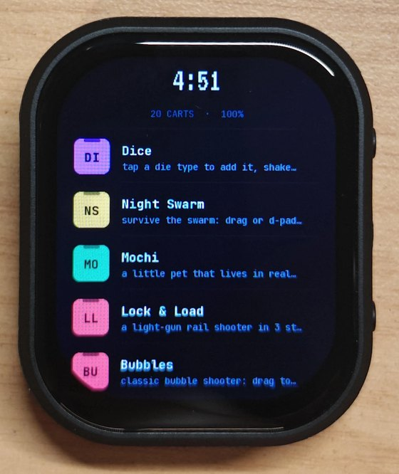
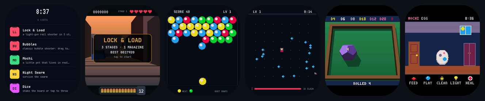

# Luanette

[](https://github.com/Geofresh/luanette/actions/workflows/ci.yml)

A Lua game console for ESP32-S3 boards. A game, or cart, is one Lua file. It draws into a
128x128 picture of 16 colors, and can add a lit 3D scene under it and a full-color layer over
it, at up to 60 fps. It can play its own sounds and music too. You write a cart in the browser or
on your computer, and send it to the board over USB.

The name is Lua plus *lunette*, French for a little moon or a small window.

**[Try it in your browser](https://geofresh.github.io/luanette/).** The example and gallery carts
run there on the same engine, compiled to WebAssembly, next to an editor with code, sprite, sound
and music tabs. It works on a phone too. The same page can put the firmware on a board and send it
your cart, so a board, a cable and Chrome or Edge are all you need to start.





It's in the spirit of PICO-8 but not compatible with it; the API is its own (`docs/api.md`).
One board is supported so far, the Waveshare ESP32-S3-Touch-AMOLED-2.06 (410x502 AMOLED,
touch, IMU, speaker). Only `board/` knows about it.

## Why it's fast

- **Only changed pixels are sent.** The panel keeps its own copy of the image, so each frame
  sends just the rows and columns that changed. A still screen sends nothing, and a ticking
  clock costs a few thousand pixels instead of the whole 410x502.
- **Frames are timed to the panel.** The panel redraws itself top to bottom 59.7 times a second
  and signals each pass. Every strip of a frame is sent right behind that pass, or just ahead of
  it when there's time. A frame never shows half drawn.
- **Both cores work.** Lua runs on one core while the other composes and sends the last frame.
  A 3D scene is never stored as a full image: each strip is drawn just before it goes out, split
  across both cores.
- **Hot loops use the S3's vector instructions.** Each one is checked bit for bit against plain
  C on the board itself.

Measured on the AMOLED-2.06:

| What | Result |
|---|---|
| 3D, two lit rings of 3,200 triangles | 59 fps at 384x384 |
| The same scene in Jet, the 3D library the stage builds on | 26 fps at 192x192 |
| The launcher, idle | 1.3 ms of Lua a frame, 2 frames a second |
| Sending a cart over USB | under a second |

`docs/ARCHITECTURE.md` explains how each of these works.

## The playground

[geofresh.github.io/luanette](https://geofresh.github.io/luanette/) opens on every cart there is,
with a picture of each: the examples, the gallery and your own. Pick one and it opens next to its
code. Edit it and press Run (or Ctrl+Enter) to see the change. The cart's name at the top switches
to another, the Luanette logo goes back to all of them, and the File, Share and Board menus hold
the rest. `?` lists the keys.

- **Code.** Mistakes are marked as you type, with the line. Hover a name for its help, or press
  Ctrl+Space for the list. Ctrl+F finds, Ctrl+H replaces. A strip of the cart's 16 colors types a
  color's number when you click it.
- **Sprites, Map, Sounds and Music.** The Sprites tab draws the cart's 8x8 sprites (up to 256) and
  their flags, and the Map tab paints levels with them, up to 128 x 64 cells, for `map()` to draw. The Sounds tab is a
  note grid: pick an instrument and an effect, draw pitch and volume, and press Play. The Music tab
  strings sounds into a song, up to four playing at once. All four write into the cart's code.
  Open Overdrive to see a finished song.
- **Running it.** Under the screen are Pause, Step (one frame at a time), Restart, the page's volume,
  and a meter of how much of the frame's 30,000 Lua instructions the cart used. What the cart
  `log()`s shows in the Console, with the frame it came in.
- **Play mode** shows the screen alone, full screen. On a phone it adds a d-pad and A and B buttons,
  and a cart picked from the list opens in it. Keys and a gamepad work too.
- **Your own carts.** File, New cart starts one from a template: blank, platformer, shooter or
  puzzle. Open a .lua file (or drop one on the page) and Save as .lua move them in and out as files.
  They're kept in your browser as you type. File, Add a library puts tested code in the cart
  ([`libs/`](libs/)): moving through a map, a camera, animations, tweens, a text box and more.
- **Sharing.** Share, Copy a share link puts the whole cart in a link, code, sounds and song.
  Whoever opens it gets the cart in their playground. Nothing is uploaded; the link is the only
  copy. Copy a link to play it does the same, but opens in play mode. Record a 5 s GIF saves what
  the screen shows.
- **The gallery** is carts people have made. **Share, Submit to the gallery** puts yours forward:
  it opens a GitHub issue with the cart's link in it ([`gallery/`](gallery/)).
- **On a board** (Chrome or Edge on a computer), from the Board menu: Install puts the latest
  firmware on it, and Send this cart to the board sends the one you're editing. Remove from board
  takes one off again; on an example it's Restore the built-in.

On Linux, Chrome can only open the board's port if your user is in the `dialout` group.

## What's in the repo

- `engine/`: the Lua runtime, the renderer, the 3D stage, and the synth for sounds and music
- `board/`: drivers for the AMOLED-2.06
- `firmware/`: the firmware, with a launcher and the examples built in
- `tools/`: check a cart, preview it, send it, take a screenshot
- `web/`: the playground
- `cli/`: the command-line tool and MCP server (npm `luanette`)
- `examples/`: seven complete carts
- `gallery/`: carts people have put forward, shown in the playground
- `templates/`: the carts New cart starts from
- `libs/`: libraries a cart can include (movement through a map, a camera, animation, tweens,
  timers, a text box, particles, scenes, vectors), each with a demo
- `docs/`: the API, a tutorial, how to make a cart run well, and how it all works

## What you need

- A Waveshare ESP32-S3-Touch-AMOLED-2.06 and a USB-C cable.
- Chrome or Edge, for the playground's Install and Send this cart to the board. That's enough to
  get going.
- To check and run carts on your computer without building anything: Node 18 or newer, for
  `npx luanette` (below).
- To work from the command line instead: `esptool` to flash the prebuilt firmware, or
  [PlatformIO](https://platformio.org/) to build it (it fetches ESP-IDF on its own); and for the
  tools, Python 3.10 or newer with its development headers (`python3-dev` or `python3-devel`, or a
  Python from uv or pyenv), a C++17 compiler and CMake.

I've only used it on Linux. macOS should work. On Windows, `cartrun`, which previews 3D and
full-color carts, doesn't build yet, and `push.py` needs `--port COM3` or similar.

## Quick start

The quickest way is the [playground](https://geofresh.github.io/luanette/) in Chrome or Edge: plug
the board in, open the **Board** menu, press **Install Luanette**, and leave "Erase device" unticked.
Then pick a cart, change something, and press **Board, Send this cart to the board**.

Or flash the four files from the [latest release](https://github.com/Geofresh/luanette/releases/latest)
yourself:

```bash
pip install esptool
esptool --chip esp32s3 write-flash 0x0 bootloader.bin 0x8000 partitions.bin 0x19000 ota_data_initial.bin 0x20000 luanette.bin
```

This leaves the rest of the flash alone, so saves and sent carts survive an update. To build it
yourself instead:

```bash
cd firmware
pio run -t upload
```

The board boots into the launcher with the seven examples. Then set up the tools:

```bash
python -m venv .venv && . .venv/bin/activate
pip install -r tools/requirements.txt
python tools/build_lupa32.py        # Lua with the board's 32-bit numbers, for check.py
cmake -S host -B host/build && cmake --build host/build
```

Change something in an example, a color or a speed, and send it. Your copy replaces the
built-in one:

```bash
python tools/push.py examples/bubbles.lua
```

`push.py` runs the cart through `check.py` first, so a broken cart never reaches the board. It
also sets the board's clock and timezone from your computer. Sent carts stay in flash.

To take a screenshot:

```bash
python tools/shot.py bubbles.png
```

## Using it

- Tap is A, drag is the d-pad, and the BOOT key is B.
- Swipe down from the top edge, or press PWR, to leave a cart.
- The launcher shows the battery next to the cart count. Tap the clock (or the Settings row at the
  end of the list) for volume, brightness and the battery's details.
- PWR in the launcher turns the screen off. Any key or a touch turns it back on.
- The screen dims after a minute and turns off after ten. While it's off, the chip sleeps.
- Below 3.4 V the board shuts itself down. Plug it in to start it again.

There's no Wi-Fi to set up: carts arrive over the USB cable, and the board needs nothing else.

## Writing a cart

New to it? [`docs/tutorial.md`](docs/tutorial.md) makes a small game from nothing in the
playground, with its own sounds and a song, in about half an hour.

```lua
-- title: Hello
-- by: you
-- about: a dot you move with your finger
-- api: 6

x, y = 64, 64

function _update()
  if btn(0) then x = x - 1 end
  if btn(1) then x = x + 1 end
  if btn(2) then y = y - 1 end
  if btn(3) then y = y + 1 end
end

function _draw()
  cls(1)
  circfill(x, y, 4, 8)
  print("hello", 2, 2, 7)
end
```

```bash
npx luanette check hello.lua                          # runs it here and enforces the limits
python tools/check.py hello.lua --preview hello.png   # the same, from the Python tools
python tools/push.py hello.lua
```

Sprites are 8x8, in a `SPRITES` table, a string of 64 hex digits each (a color per pixel, row by
row); `spr(1, x, y)` draws one. The playground's Sprites tab draws them for you. A `MAP` table is a
grid of them, a character a cell, drawn with `map()` and read with `mget()`: levels bigger than the
screen, in one call. The platformer template shows how. `log(...)` writes a
line to the playground's Console, the command-line tool's output, and the board's serial log.

A cart's own sounds and song live in its code, in two tables, `SOUNDS` and `MUSIC`. They're
text, but the easy way to make them is the playground's Sounds and Music tabs. `sfx(8)` plays a
sound, `music(0)` starts the song, and `-1` stops either. The eight built-in sounds, `sfx(0)` to
`sfx(7)`, need nothing.

- [`docs/api.md`](docs/api.md) is the full API: drawing, input, the color layer, images, 3D,
  sound and music, and saves.
- [`docs/DESIGN.md`](docs/DESIGN.md) covers making a cart run well. Read it before writing
  anything big.
- [`examples/`](examples/) has seven complete carts, from a bubble shooter to a 3D rail shooter, a chiptune and a world of 1,024 screens.
- [`templates/`](templates/) has four small ones to start from.

A cart gets 32 KB of source (comments don't count), 1 MB of memory and 2 KB of saved data.
`check.py` and the playground allow 30,000 Lua instructions a frame; the board stops a frame that runs
past 100 ms.

## Making carts with an agent

Carts are plain text, so coding agents can make them too. The command-line tool runs the console's
own engine in Node, with nothing to build:

```bash
npx luanette new game --template platformer
npx luanette check game.lua             # JSON: ok, the error and its line, warnings, the log
npx luanette run game.lua --input play.json --shots 1,30,90   # play it, then look at the PNGs
npx luanette link game.lua              # a link that opens it in the playground (--play: in play mode)
npx luanette add actor cam game.lua     # libraries: map movement, a camera, and more (libs/)
```

`npx luanette mcp` is the same as an MCP server (`claude mcp add luanette -- npx -y luanette mcp`
for Claude Code). An agent should read [`AGENTS.md`](AGENTS.md) first; [`docs/cli.md`](docs/cli.md)
has every command, and [`llms.txt`](llms.txt) points at the rest.

## How it works

[`docs/ARCHITECTURE.md`](docs/ARCHITECTURE.md) covers the engine: how a frame gets from Lua to
the screen, the runtime's sandbox, storage, the USB protocol, how to check that a change didn't
break or slow anything, and what porting to another board takes.
[`docs/3d-stage.md`](docs/3d-stage.md) has the measurements behind the 3D stage.

## Status

It works, but so far it's had one user (me) and one board. Expect rough edges.

- One board. The engine doesn't depend on it, but the screen layout is set for this panel.
  `docs/ARCHITECTURE.md` lists what a port needs.
- Carts arrive over USB only.

## Credits

Written in collaboration with [Claude Code](https://claude.com/claude-code).

## License

MIT (`LICENSE`). Lua and Jet are MIT, the fonts are SIL OFL 1.1, and the panel's start-up table
follows Waveshare's Apache 2.0 board package. Details are in `NOTICE` and `LICENSES/`.
